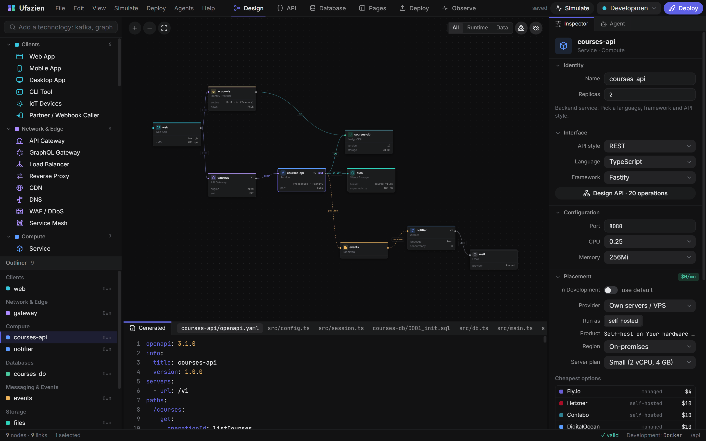
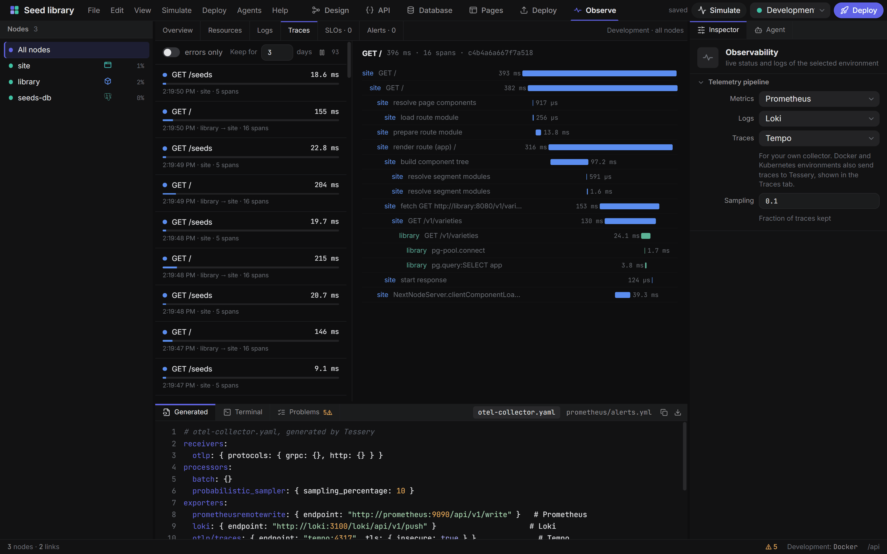
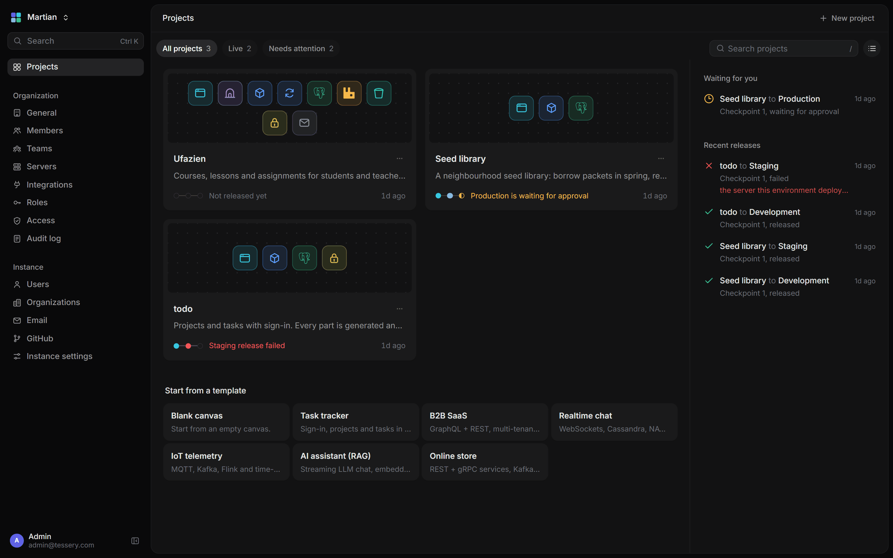
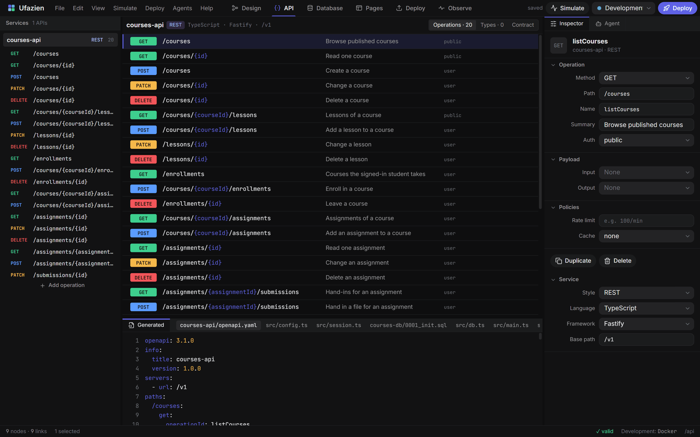
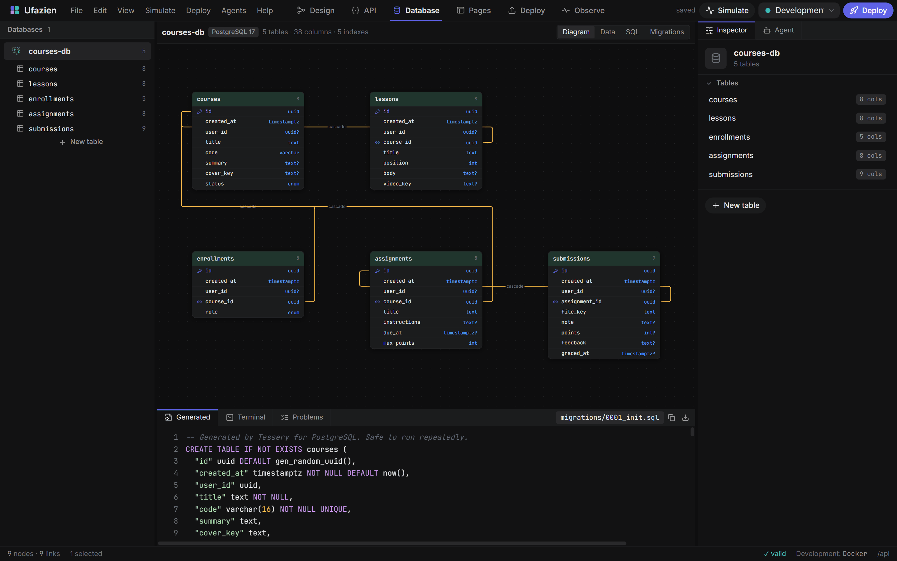
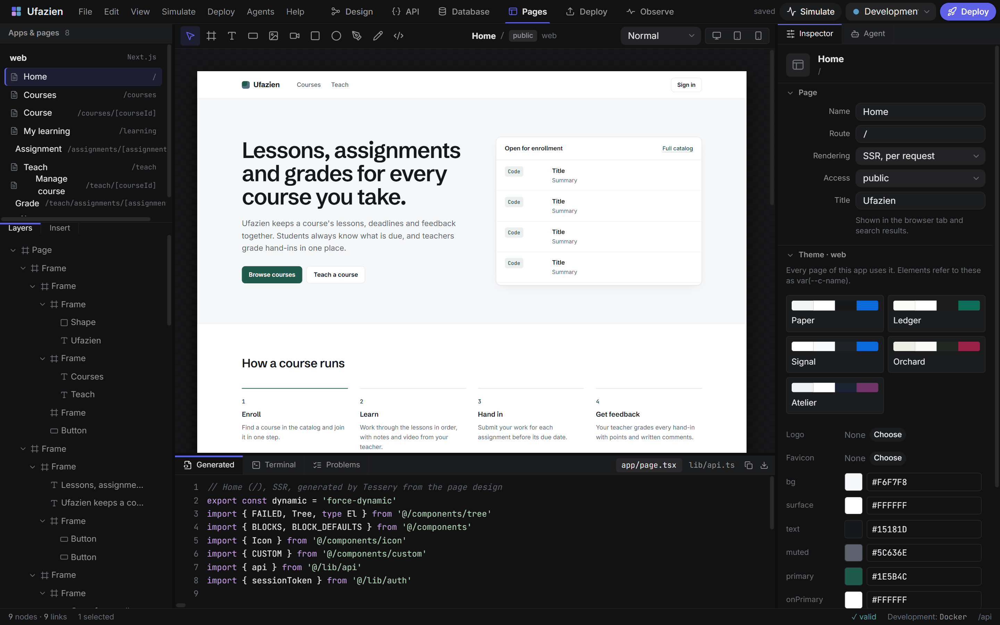
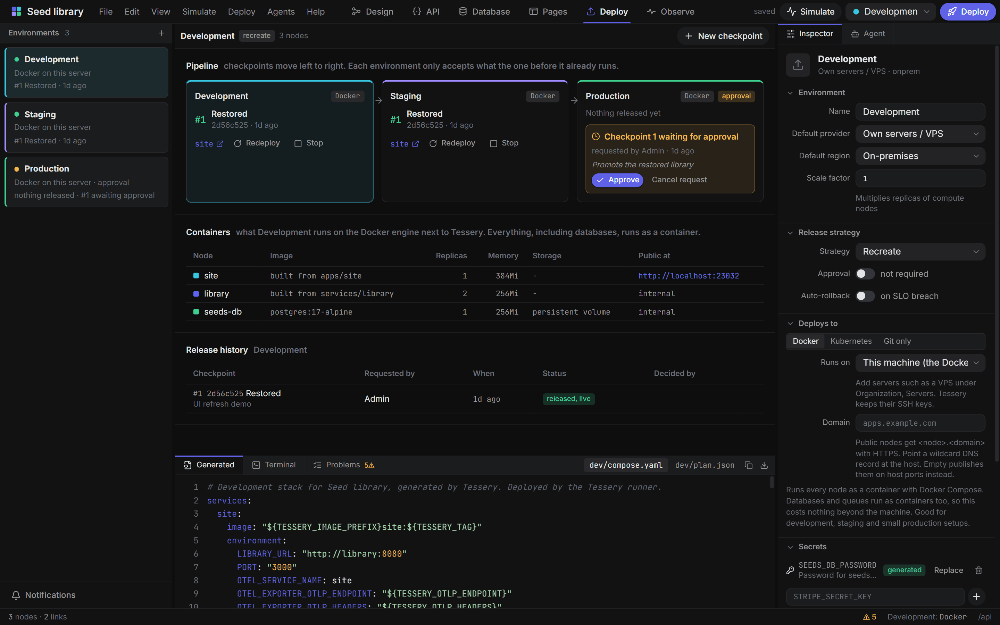
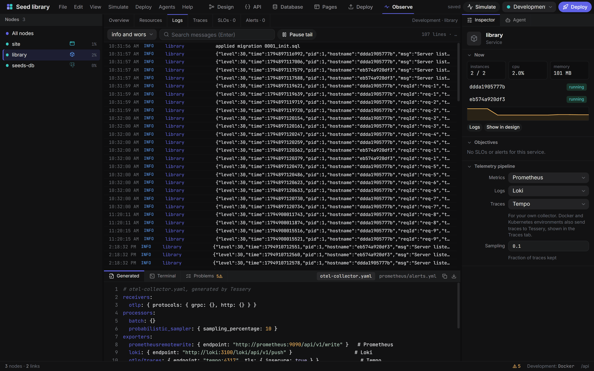

<p align="center">
  
</p>

<h1 align="center">Tessery</h1>

<p align="center">
  Design a software system, generate its code and infrastructure, and ship it from development to production on your own servers.
</p>

<p align="center">
  
  
  
  
  <a href="LICENSE"></a>
  <a href="https://github.com/martian56/tessery/commits/main"></a>
</p>

<p align="center">
  <a href="#quick-start">Quick start</a> ·
  <a href="#traces-built-in">Traces</a> ·
  <a href="#screenshots">Screenshots</a> ·
  <a href="#features">Features</a> ·
  <a href="#self-hosting">Self-hosting</a> ·
  <a href="#development">Development</a> ·
  <a href="CONTRIBUTING.md">Contributing</a>
</p>

<p align="center">
  
</p>

## What Tessery is

Tessery is a self-hosted platform where a team draws its system as services, databases, queues and web apps, then
designs each service's API, each database's schema and each web app's pages. From that design Tessery generates
working code and the infrastructure to run it, keeps both in a git repository your developers can push to, and
releases them through development, staging and production.

Everything runs on machines you control. Generated code is ordinary code in your repository, so you can keep
building on it by hand, and Tessery merges your changes with what the design generates.

## How it works

1. **Design.** Place technologies on a canvas and connect them. Design REST, GraphQL, gRPC or WebSocket operations,
   database tables and web pages in their own editors.
2. **Generate.** Tessery writes the services, migrations, a Next.js web app, Docker Compose files and Kubernetes
   manifests, and shows every file as you edit.
3. **Commit.** A checkpoint commits the generated files to the project's git repository and merges them into
   `main` next to your hand-written code.
4. **Release.** Promote a checkpoint through your environments. Each one only accepts what the previous one runs,
   and any of them can require approval.
5. **Operate.** Follow every request through your services as a trace, and watch status, CPU and memory and logs
   for every environment.

## Traces built in

The web apps and the TypeScript, Go and Python services Tessery generates come instrumented with OpenTelemetry,
and every Docker or Kubernetes environment it deploys sends their traces back to Tessery. There is no tracing
backend to set up: open Observe, then Traces, and each request shows as a waterfall across the services it touched,
down to the database queries.

<p align="center">
  
</p>

- Follow a request from the web app through every service it calls, with each span's service and duration.
- Filter to failed requests only, and choose how many days each environment keeps its traces.
- Prefer your own stack? Point the environment at your OpenTelemetry collector, Tempo or Jaeger; Tessery
  generates the collector configuration.

## Screenshots

<table>
  <tr>
    <td width="50%"><br><b>Projects.</b> Each project's design and release pipeline, with releases waiting for approval first.</td>
    <td width="50%"><br><b>API designer.</b> Operations, access rules and the OpenAPI contract they generate.</td>
  </tr>
  <tr>
    <td><br><b>Schema designer.</b> Tables, references and the SQL migration that creates them.</td>
    <td><br><b>Page builder.</b> Pages bound to the API, themed per app, rendered as a Next.js app.</td>
  </tr>
  <tr>
    <td><br><b>Releases.</b> Development, staging and production, with approval before production.</td>
    <td><br><b>Observe.</b> Live instances, resource use and logs for every running service.</td>
  </tr>
</table>

## Features

**Design**
- A canvas of 69 technologies, from Postgres, Redis and Kafka to object storage, identity providers and LLM APIs.
  Each node can run self-hosted, on a managed service or as SaaS, with cost estimates per provider.
- Editors for APIs (REST, GraphQL, gRPC, WebSocket), database schemas and web pages, all changing one design
  document with undo and version history.
- Templates for a task tracker, a B2B SaaS, a realtime chat, IoT telemetry, an AI assistant and an online store.

**Generate**
- Services in TypeScript, Go, Python, Rust, Java, Kotlin, Scala, C#, Ruby, PHP, Elixir, Swift, C++ and Zig, a
  Next.js web app, Docker Compose files and Kubernetes manifests.
- REST operations whose path names a table of a connected Postgres, such as `GET /orders` or
  `PATCH /orders/{id}`, are implemented in SQL for TypeScript, Go, Python, Java, Kotlin, C# and Rust. A designed
  CRUD app works without writing code.
- Add the built-in identity provider and Tessery generates sign-up, sign-in, sessions, a login page, access checks
  for operations marked for signed-in users or admins, and per-user rows for tables with a `user_id` column.

**Ship**
- Every project has a git repository at `/git/<project>.git`. Developers clone it with an API token, run it with
  `docker compose up --build` and push to `main`.
- Environments form a pipeline with optional approval and automatic rollback. Targets are Docker on the Tessery
  host, Docker on any machine over SSH, or Kubernetes.
- A throwaway runner container builds the images, starts everything, checks health and streams its log to the UI.

**Operate**
- Distributed tracing with nothing to install: generated web apps and TypeScript, Go and Python services send
  OpenTelemetry traces to Tessery, which stores them and shows each request as a waterfall across services.
- Live status, CPU and memory, logs, table browsing and SQL for every environment.
- Release notifications by email (SMTP or Resend), Slack, Discord, Telegram or webhook.

**Teams and access**
- Organizations, teams, built-in and custom roles granted at organization, team, project or environment level,
  time-limited grants, scoped API tokens, single sign-on with any OpenID Connect provider and an audit log.
- An MCP server at `/api/mcp` lets Claude Code, Cursor or any MCP client design, build and deploy with the
  permissions of the token it uses.

## Quick start

On a Linux server with a domain pointing at it:

```sh
curl -fsSL https://raw.githubusercontent.com/martian56/tessery/main/deploy/install.sh | sudo bash
```

The script installs Docker if needed, asks for the domain, writes `/opt/tessery/.env` with generated secrets and
starts the published images behind Caddy, which serves HTTPS. Open the domain in a browser and create the instance
administrator.

To try it on your own machine instead, follow [Development](#development).

## Self-hosting

The full guide, including updates, automatic updates and rolling back, is [docs/self-hosting.md](docs/self-hosting.md).

Only ports 80 and 443 are opened; Postgres, Redis and RabbitMQ stay on the internal network. Every setting is
described in [`deploy/.env.example`](deploy/.env.example). Set `TESSERY_IMAGE_TAG` in `.env` to pin a version.

**Updates.** Instance admins update from Instance admin, Updates, by hand or automatically inside a daily window,
and can roll back to the previous version from the same page.

Back up `.env`. `TESSERY_SECRET_KEY` encrypts environment secrets, git credentials and provider credentials and
cannot be recovered.

**Backups.** `sudo /opt/tessery/backup.sh` writes one archive with the database, the project repositories and
`.env` to `/opt/tessery/backups`. With `TESSERY_BACKUP_S3_BUCKET`, `TESSERY_BACKUP_S3_ENDPOINT`,
`TESSERY_BACKUP_S3_ACCESS_KEY` and `TESSERY_BACKUP_S3_SECRET_KEY` set, it also uploads the archive to any
S3-compatible bucket. Restore with `sudo /opt/tessery/restore.sh <archive>` on the same or a new machine after
running `install.sh`. Run `backup.sh` from cron for regular backups.

**Email.** Password resets, invitations and notifications are sent once an instance admin sets up email under
Instance settings, Email, with a Resend API key or an SMTP server.

<details>
<summary><b>Rotating the secret key</b></summary>

Change `TESSERY_SECRET_KEY` when it may have leaked, or on a schedule. In `/opt/tessery`:

1. Generate a new key with `openssl rand -hex 32`. In `.env`, move the current value to
   `TESSERY_SECRET_KEY_PREVIOUS` and put the new one in `TESSERY_SECRET_KEY`.
2. Run `docker compose up -d`. Tessery now writes with the new key and still reads with the old one.
3. Run `docker compose exec server tessery-server rotate-key`. It re-encrypts every stored value in one
   transaction and prints how many it moved. If any value cannot be read, it changes nothing.
4. Redeploy environments that send traces, so they get telemetry tokens made from the new key.
5. Remove `TESSERY_SECRET_KEY_PREVIOUS` from `.env` and run `docker compose up -d` again.

Take a backup first; archives made before the rotation need the old key to restore.

</details>

## Connecting an agent

Create a token under Account, API tokens, or from a project's Agent panel, then:

```sh
claude mcp add --transport http tessery https://tessery.example.com/api/mcp --header "Authorization: Bearer tessery_..."
```

## Development

Requirements: Docker, Node 22 or newer, Rust 1.99.1 and git.

```sh
docker compose up -d                                   # Postgres, Redis, RabbitMQ and object storage
cd packages/core && npm ci && npm run build:engine && cd ../..
cd apps/server && cp .env.example .env                 # then set TESSERY_SECRET_KEY (openssl rand -hex 32)
cargo run --bin tessery-server                         # API on http://127.0.0.1:8080
cargo run --bin tessery-worker                         # in a second terminal
cd apps/web && npm ci && npm run dev                   # web app on http://localhost:5173
```

The first visit asks you to create the instance administrator. The root `docker-compose.yml` is for development
only: it uses fixed passwords and publishes the database ports.

Tests:

```sh
cd apps/server && cargo test --workspace               # needs the services from docker compose up -d
cd packages/core && npm test
cd apps/web && npx tsc --noEmit -p .
```

### Repository layout

| Path | Contents |
|---|---|
| `apps/web` | Web app: React, Vite, Redux Toolkit, React Flow |
| `apps/server` | Rust workspace: `tessery-api` (HTTP server), `tessery-worker` (jobs and deploys), `tessery-db`, `tessery-git`, `tessery-engine`, `tessery-mq`, `tessery-notify`, `tessery-core` |
| `packages/core` | TypeScript design model and code generators, used by the browser and by the server through a pool of Node processes |
| `deploy` | Install, backup and restore scripts and the production Compose file |

## Contributing

Issues and pull requests are welcome. Read [CONTRIBUTING.md](CONTRIBUTING.md) for branches, commit messages and
pull requests, and report security problems as described in [SECURITY.md](SECURITY.md). Maintainers cut releases as
described in [docs/releasing.md](docs/releasing.md).

## License

Tessery is released under the [MIT License](LICENSE).
